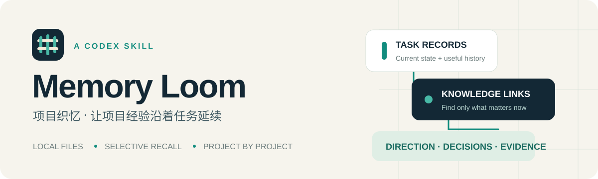

<p align="center"></p>

<p align="center"><a href="README.md">中文</a> · <strong>English</strong></p>

# Memory Loom

**Durable project memory, one task at a time.**

Memory Loom is a Codex skill that keeps task history, decisions and handoff notes in the project itself. It retrieves relevant records when needed, continues the same task across chats, and keeps unrelated projects separate. It needs no database, API key or external memory service.

## Install

Requires Codex, Python 3.9+ and system IANA timezone data (normally available on macOS and Linux).

```sh
git clone https://github.com/xx1999DK/codex-memory-loom.git
cd codex-memory-loom
python3 tools/install_skill.py
```

The default destination is `~/.agents/skills/memory-loom`. In a Codex chat for your target project, say:

```text
Use $memory-loom to enable project-local memory for this project.
Keep this project's records in English.
```

Enable it once per project. Work normally, or ask to resume a previous task, retrieve the reason behind a decision, or refresh the project's direction summary. The skill's instructions are in Chinese and respect the project's language convention.

If it does not appear, start a new chat or restart Codex. You can also point Codex at [SKILL.md](memory-loom/SKILL.md). Keep the entire skill directory together. ZIP bundles are available under [Releases](https://github.com/xx1999DK/codex-memory-loom/releases).

## Memory layout

```text
your-project/
├── AGENTS.md                 # Small entry point; uses an active override if present
└── .project-memory/
    ├── config.json           # Project identity, timezone and task directory
    ├── MEMORY.md             # Retrieval and recording workflow
    ├── INDEX.md              # Task navigation and knowledge links
    ├── DIRECTION.md          # Goals, current decisions and lessons
    └── tasks/                # One Markdown record per independent task
```

- **Continue by goal.** Follow-up questions, fixes and validation update the original record. A new chat does not imply a new task.
- **Retrieve selectively.** Search the index or metadata, open a relevant handoff summary, then read evidence as needed.
- **Keep current state and history.** The handoff summary describes today's state; dated updates preserve useful history.
- **Keep conclusions traceable.** Direction summaries cite source tasks and distinguish evidence, assumptions and superseded decisions.
- **Reuse existing records.** Configure an existing project-local task directory without rewriting its old files.

Project identities and path checks prevent common accidental mixing. They do not create an operating-system sandbox.

## CLI

```sh
SKILL_DIR="$HOME/.agents/skills/memory-loom"
PROJECT_ROOT='/absolute/path/to/your-project'
python3 "$SKILL_DIR/scripts/memory.py" init --root "$PROJECT_ROOT" --timezone UTC
python3 "$SKILL_DIR/scripts/memory.py" new-task --root "$PROJECT_ROOT" --title 'Fix CSV export' --summary 'Resolve CSV encoding issues' --keywords CSV export
python3 "$SKILL_DIR/scripts/memory.py" search --root "$PROJECT_ROOT" --query 'CSV export' --limit 5
python3 "$SKILL_DIR/scripts/memory.py" reindex --root "$PROJECT_ROOT"
python3 "$SKILL_DIR/scripts/memory.py" check --root "$PROJECT_ROOT"
```

Initialization defaults to `Asia/Shanghai`; use your project's timezone if different. `search` is read-only and bounded; `--include-body` enables body matching. It never returns full documents. `reindex` preserves manually maintained links outside its table. `check` validates structure and consistency, not factual truth. The model decides whether a request continues a task; `new-task` only creates its record.

## Update

```sh
git pull --ff-only
python3 tools/install_skill.py --update
```

The installer backs up recognized existing installs and protects local changes. Use `--destination /absolute/path/to/skills/memory-loom` for a custom location. Skill updates do not overwrite workflows or records in existing projects.

Manually extracted ZIP installs have no installer manifest and are protected from replacement. To switch to managed installation, first move that directory to a backup outside skill discovery, then run the installer.

The prototype used the skill name `project-memory`. The invocation is now `$memory-loom`; `.project-memory/`, schema version `1`, project IDs, task IDs and managed markers are unchanged. Back up the old skill and move it outside discovery directories; project data needs no renaming or reset.

## Limits

This is an instruction-driven file workflow. It does not alter model weights, enlarge the context window, monitor project creation or run in the background. A crash can interrupt the final write. Project instructions must be loaded from the intended project. Direct concurrent Markdown edits still need coordination; the script lock protects script operations only.

Do not store credentials. Decide how to back up, version and share memory under your own project rules. These scripts contact no external memory service.

This is an independent community project, not affiliated with OpenAI. It follows the documented [Skills](https://learn.chatgpt.com/docs/build-skills) and [AGENTS.md](https://learn.chatgpt.com/docs/agent-configuration/agents-md) mechanisms.

## Development

```sh
python3 -m unittest discover -s tests -v
python3 tools/package_skill.py
```

Packaging produces a deterministic versioned ZIP and `SHA256SUMS`. See [CONTRIBUTING.md](CONTRIBUTING.md) and [CHANGELOG.md](CHANGELOG.md).

Released under the [MIT License](LICENSE).
