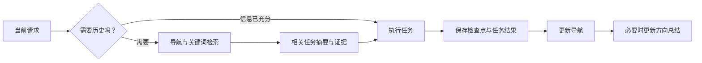

<p align="center"></p>

<p align="center">
  <a href="https://github.com/xx1999DK/codex-memory-loom/actions/workflows/ci.yml"></a>
  <a href="LICENSE"></a>
  
  <a href="https://github.com/xx1999DK/codex-memory-loom/releases"></a>
</p>

<p align="center"><strong>中文</strong> · <a href="README.en.md">English</a></p>

**Memory Loom（项目织忆）** 是一个为 Codex 提供项目文件记忆的 skill。它把任务、决定和经验保存在项目里，在需要时找回相关内容，让新聊天能够接续之前的工作。

每个项目独立保存；同一个任务持续更新；历史按需检索。无需数据库、API Key 或外部记忆服务。

## 快速开始

需要 Codex、Python 3.9+ 和系统 IANA 时区数据。macOS 和常见 Linux 发行版通常已提供时区数据。

```sh
git clone https://github.com/xx1999DK/codex-memory-loom.git
cd codex-memory-loom
python3 tools/install_skill.py
```

默认安装到 `~/.agents/skills/memory-loom`。然后在**目标项目**的 Codex 聊天里输入：

```text
使用 $memory-loom 为当前项目启用长记忆。
```

每个项目只需首次启用。后续正常开展工作；需要接续时可以说：

```text
继续上次的 CSV 导出任务，先查相关记忆。
我们之前为什么选择这个方案？请找到当时的依据。
整理这个项目的方向总结，标出已经过时的结论。
```

如果选择器未出现，开启新聊天或重启 Codex；也可以让 Codex 直接读取 [SKILL.md](memory-loom/SKILL.md)。安装需要整个 `memory-loom/` 目录，不能只复制入口文件。[Releases](https://github.com/xx1999DK/codex-memory-loom/releases) 的 ZIP 解压后也可直接放入自己的 skills 目录。

## 它怎样工作



| 能力 | 具体做法 |
| --- | --- |
| 项目隔离 | 每个项目一个身份与记忆目录，脚本只处理明确指定的根目录 |
| 任务续写 | 同一目标的追问、修复、优化、验证更新原记录；新聊天不等于新任务 |
| 按需检索 | 先定位，再读少量相关摘要，必要时才打开历史正文 |
| 记录详略 | 小任务简记；复杂任务保存约束、决定、失败原因、验证和下一步 |
| 知识导航 | 用主题、模块、决定、任务和文件之间的链接组织关系 |
| 方向复盘 | 总结注明来源与适用范围，旧结论被推翻时同步纠正 |
| 可恢复性 | 关键阶段保存检查点；收尾同步任务、导航与必要的总结 |

```text
your-project/
├── AGENTS.md                 # 简短入口；已有 override 生效时写入 override
└── .project-memory/
    ├── config.json           # 项目身份、时区、任务目录
    ├── MEMORY.md             # 日常工作流
    ├── INDEX.md              # 任务导航与知识关系
    ├── DIRECTION.md          # 当前目标、有效决定与经验
    └── tasks/                # 每个独立任务一份 Markdown
```

已有 `工作记录/` 等档案可以作为任务目录复用，旧文件不会被自动重写。每份任务记录由**当前交接摘要 + 带日期的更新历史**组成。长期任务继续使用原文件名与 ID。

## 命令行工具

Codex 会按 skill 调用这些命令；也可以直接运行。把项目路径换成自己的实际目录。

```sh
SKILL_DIR="$HOME/.agents/skills/memory-loom"
PROJECT_ROOT='/absolute/path/to/your-project'
python3 "$SKILL_DIR/scripts/memory.py" init --root "$PROJECT_ROOT"
python3 "$SKILL_DIR/scripts/memory.py" new-task --root "$PROJECT_ROOT" --title '修复 CSV 导出' --summary '定位并修复中文乱码' --keywords CSV 导出
python3 "$SKILL_DIR/scripts/memory.py" search --root "$PROJECT_ROOT" --query 'CSV 导出' --limit 5
python3 "$SKILL_DIR/scripts/memory.py" reindex --root "$PROJECT_ROOT"
python3 "$SKILL_DIR/scripts/memory.py" check --root "$PROJECT_ROOT"
```

- `init`：幂等初始化，保留已有指令与内容；可加 `--tasks-dir 工作记录`、`--timezone Asia/Shanghai`。
- `new-task`：只建档，不推断是否同一任务，也不代替执行工作。
- `search`：只读、限量搜索元信息；加 `--include-body` 才匹配任务正文，不输出整篇档案。
- `reindex`：重建有标记的任务表，保留表外手工维护的知识关系。
- `check`：只读检查结构、身份、元信息及索引一致性。

续写任务时由 Codex 编辑原正文与元信息，再重建索引。细则见 [记录与检索](memory-loom/references/records.md) 和 [维护说明](memory-loom/references/maintenance.md)。

## 更新与兼容

```sh
git pull --ff-only
python3 tools/install_skill.py --update
```

安装器为可识别的旧安装保留备份，拒绝覆盖未经处理的本地改动。自定义位置用 `--destination /absolute/path/to/skills/memory-loom`。更新 skill **不会自动改写现有项目的工作流或记忆**，升级项目工作流时需对比模板并保留项目约定。

直接解压 ZIP 的目录没有安装器 manifest，安装器会保护该目录；若要改用安装器管理，先将旧目录备份到 skills 目录之外，再重新安装。

早期原型名为 `project-memory`，现在使用 `$memory-loom`。磁盘上的 `.project-memory/`、配置版本 `1`、任务 ID 和导航标记保持兼容，无需移动或清空记忆。旧 skill 安装应先备份，再移出发现目录，避免维护两套方法。

## 能力边界

这是由项目指令驱动的文件记忆。它不会修改模型参数、增加上下文窗口、监控“新建项目”事件或在后台记录每条聊天。正常收尾依赖 Codex 遵循项目指令，异常退出前最后一步可能尚未保存。

文件仍受当前工作区权限控制；项目 ID 与路径检查帮助避免误混，**不是操作系统沙箱**。记忆不应含凭据，是否提交、备份或共享由项目自行决定。脚本锁只保护脚本写入；多聊天直接编辑同一份 Markdown 时仍需协调。`check` 通过不代表结论真实或语义分流正确。

本项目是独立社区项目，与 OpenAI 无隶属关系。加载机制参考官方 [Skills](https://learn.chatgpt.com/docs/build-skills) 和 [AGENTS.md](https://learn.chatgpt.com/docs/agent-configuration/agents-md) 文档。

## 开发与发布

```sh
python3 -m unittest discover -s tests -v
python3 tools/package_skill.py
```

发布工具生成带版本的 ZIP 与 `SHA256SUMS`；相同源码生成相同字节。测试覆盖项目边界、稳定任务身份、初始化保护、搜索、索引、安装和打包。CI 在 Linux 和 macOS 上运行。贡献方式见 [CONTRIBUTING.md](CONTRIBUTING.md)。

代码、文档和图形使用 [MIT License](LICENSE)。
